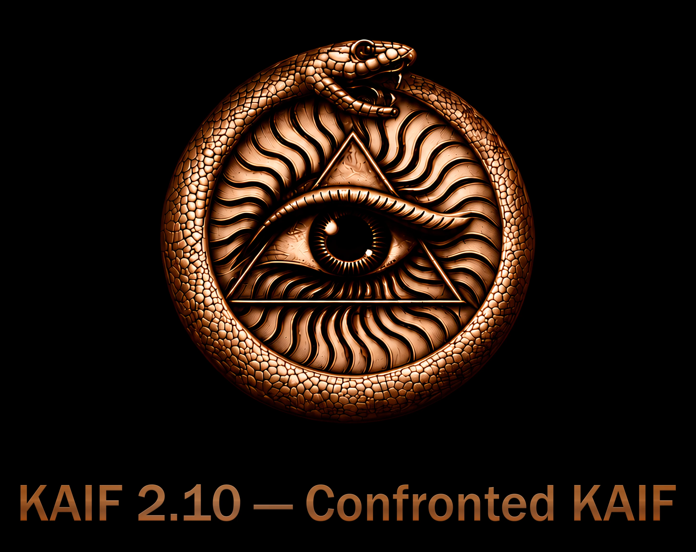

<!--
  Release-body form: every prose paragraph is ONE line. GitHub preserves single line breaks.
  Before publishing, run the release-body guard and open the rendered release page.
-->

  

> **Release date: 2026-11-21** · Minsk.

## English · [Русский](#русский)

**KAIF 2.10 — Confronted KAIF** is focused on adapting KAIF to Kimi Code. Development of the framework's core functionality continues in 2.11 with Kimi as the target agent system. This release carries the current work as it stands; unfinished 2.10 features move to 2.11 and are not presented here as completed.

What KAIF is and how to use it — the [README](https://github.com/MikalaiKryvusha/KAIF#english). This page covers the release delta.

---

### ✨ What's new in 2.10

**1. Kimi Code is a native target.** `--agents kimi-code` writes `AGENTS.md` and all 37 skills into `.kimi-code/skills/<name>/SKILL.md`, including their references. Kimi-specific copies do not collide with Codex's `.agents/skills/`. `check`, `sync` and `update-verify` share one transformation, so a canonical edit reaches the Kimi copy mechanically.

**2. Localized skill metadata is valid YAML.** KAIF descriptions can contain `: `, and localization appends `Trigger aliases (<lang>): …`. Kimi copies now use folded blocks (`description: >-`), explicit `/skill:<name>` calls and `${KIMI_SKILL_DIR}` resource links. Use `/skill:resume` for KAIF's entry ritual; Kimi's unprefixed `/resume` belongs to session history.

**3. The Claude hook set has a Kimi contract.** The optional `kimi-config-fragment.toml` wires prompt refresh, resume, machine time, knowledge recording, subagent briefs, STATUS freshness, test debt, context-window levels, farewell capture and the permission voice. Observation-only events carry pending work to the next prompt. Kimi usage is read as `inputOther + inputCacheRead + inputCacheCreation`; Stop blocks use exit 2 and stderr. Kimi has no documented `updatedInput`, so affected writes and subagent launches return an explicit corrected retry instead of claiming an invisible rewrite.

**4. The voice starts before Kimi waits.** On `PermissionRequest` the hook writes a localized UTF-8 phrase and starts the configured voice tool detached. `KAIF_VOICE_FILE_TOOL`, or the deployment's `contour.voiceFileTool`, accepts a command prefix with a `{file}` slot. This lets the machine's Silero + Glass voice run without holding the agent's turn. Structured questions can use `AskUserQuestion(background=true)` when work continues.

---

### ✅ Verification

A clean Russian `--agents kimi-code` install passed its manifest check and `sync`; all 37 Kimi skills and all 9 reference files were present. PyYAML 6.0.3 parsed every Kimi frontmatter. The hook suite covered the Kimi events, context levels, corrected retries, knowledge queue and wire-based farewell. The permission-voice selftest and dry-run passed, and Silero + Glass rendered a 7.14-second WAV without playback. A live Kimi session discovered all 37 project skills and executed the prompt hooks after the validated user-level configuration was activated.

---

### 📦 Installation and upgrading

Drop [`KAIF.md`](https://github.com/MikalaiKryvusha/KAIF/blob/main/KAIF.md) into your project root and ask your agent to deploy KAIF. For a Kimi-only deployment, the installer accepts `--agents kimi-code`.

For an existing deployment, add `kimi-code` to `agents` in `.kaif/kaif.json` and run `node .kaif/kaif-core.mjs sync`. Hooks are optional: merge `.kaif/hooks/kimi-config-fragment.toml` into Kimi's user-level `config.toml`, validate with `kimi doctor config`, then use `/reload` or start a new session. The installer does not rewrite global Kimi configuration.

---

## Русский · [English](#english)

**KAIF 2.10 — Confronted KAIF** сфокусирован на адаптации KAIF под Kimi Code. Развитие функциональности ядра KAIF продолжится в версии 2.11 с ориентацией на агентскую систему Kimi. Этот выпуск несёт текущую работу как есть; незавершённые фичи 2.10 переходят в 2.11 и не представлены здесь завершёнными.

Что такое KAIF и как им пользоваться — [README](https://github.com/MikalaiKryvusha/KAIF#russian). Эта страница описывает изменения текущего выпуска.

---

### ✨ Что нового в 2.10

**1. Kimi Code — родная целевая система.** Установка с `--agents kimi-code` пишет `AGENTS.md` и все 37 навыков в `.kimi-code/skills/<name>/SKILL.md` вместе с их references. Копии Kimi не пересекаются с `.agents/skills/` для Codex. Команды `check`, `sync` и `update-verify` применяют одно преобразование. Правка канонического навыка попадает в копию Kimi механически.

**2. Метаданные локализованных навыков — корректный YAML.** Описания KAIF могут содержать `: `, а локализация добавляет `Trigger aliases (<lang>): …`. Копии Kimi используют folded block (`description: >-`), явные вызовы `/skill:<name>` и ссылки на ресурсы через `${KIMI_SKILL_DIR}`. Для входа в KAIF вызывайте `/skill:resume`; команда `/resume` без префикса принадлежит истории сессий Kimi.

**3. Хуки Claude получили контракт Kimi.** Опциональный `kimi-config-fragment.toml` подключает освежение контекста, resume, машинное время, запись знаний, брифы субагентов, свежесть STATUS, тестовый долг, ступени окна, прощание и голосовой зов. События, которые только наблюдают, переносят отложенную работу в следующий промпт. Использование окна считается как `inputOther + inputCacheRead + inputCacheCreation`; блокировка Stop идёт через exit 2 и stderr. В Kimi нет документированного `updatedInput`, поэтому затронутые записи и запуски субагентов возвращают явный исправленный повтор вместо заявления о невидимой перезаписи.

**4. Голос запускается до ожидания Kimi.** На `PermissionRequest` хук записывает локализованную фразу в UTF-8 и запускает настроенный голосовой инструмент фоном. `KAIF_VOICE_FILE_TOOL` или `contour.voiceFileTool` развёртывания принимает префикс команды со слотом `{file}`. Так Silero + Glass работает, не удерживая ход агента. Если работа продолжается, структурированный вопрос поддерживает `AskUserQuestion(background=true)`.

---

### ✅ Проверка

Чистая русская установка с `--agents kimi-code` прошла проверку манифеста и `sync`; на месте все 37 навыков Kimi и все 9 reference-файлов. PyYAML 6.0.3 разобрал каждый frontmatter Kimi. Свод хуков покрыл события Kimi, ступени контекста, исправленные повторы, очередь знаний и прощание из wire. Selftest и dry-run голосового хука прошли, а Silero + Glass создал WAV длительностью 7,14 секунды без проигрывания. Живая сессия Kimi обнаружила все 37 навыков проекта и исполнила хуки промптов после проверенной активации пользовательской конфигурации.

---

### 📦 Установка и обновление

Положите [`KAIF.md`](https://github.com/MikalaiKryvusha/KAIF/blob/main/KAIF.md) в корень проекта и попросите агента развернуть KAIF. Для установки только под Kimi установщик принимает `--agents kimi-code`.

В существующем развёртывании добавьте `kimi-code` в `agents` файла `.kaif/kaif.json` и запустите `node .kaif/kaif-core.mjs sync`. Хуки опциональны: добавьте `.kaif/hooks/kimi-config-fragment.toml` в пользовательский `config.toml` Kimi, проверьте через `kimi doctor config`, затем выполните `/reload` или откройте новую сессию. Установщик не переписывает глобальную конфигурацию Kimi.
